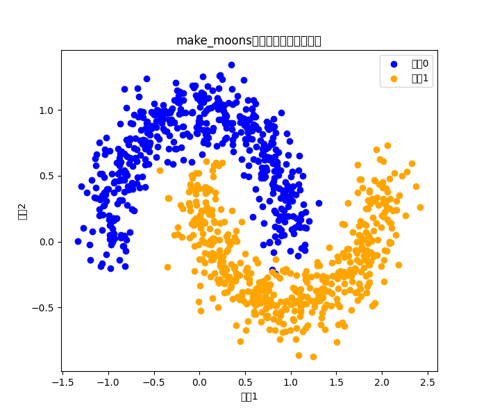
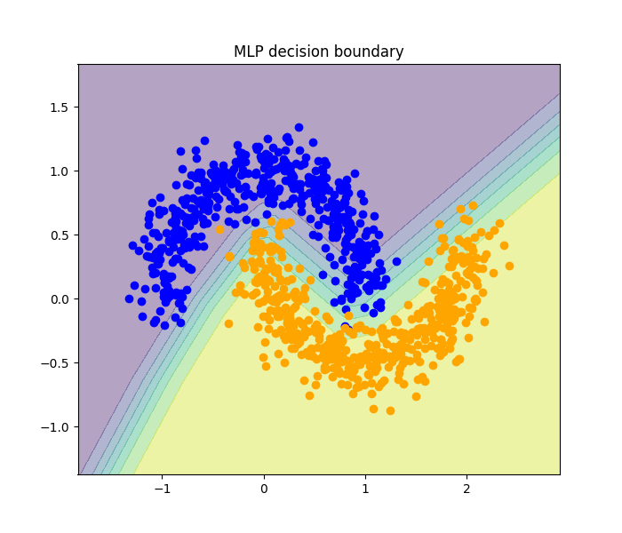
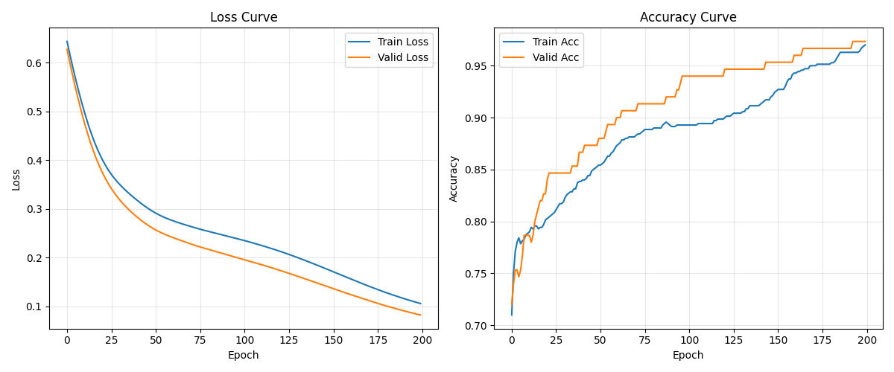
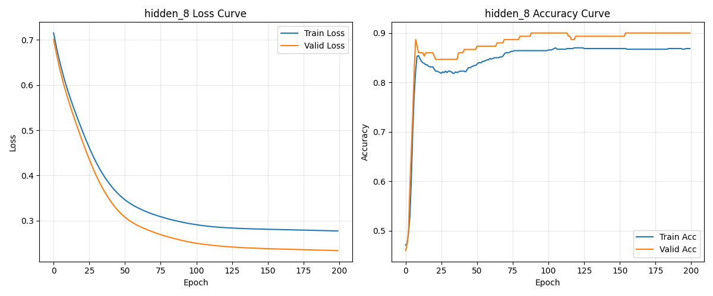
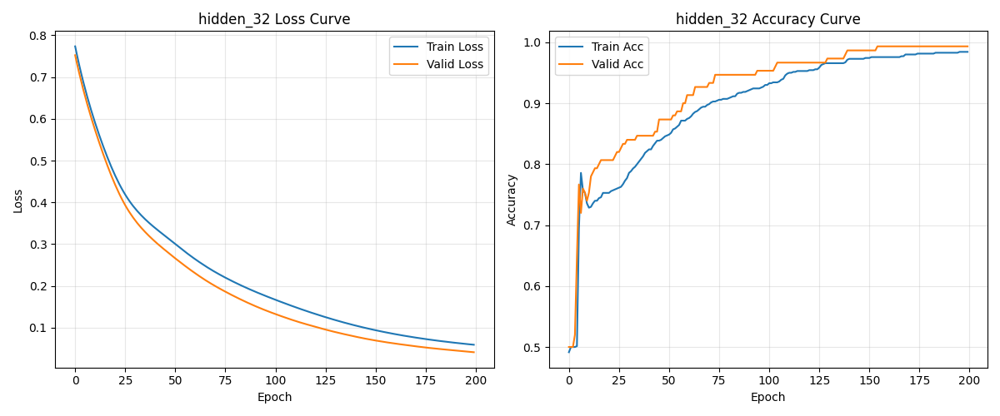
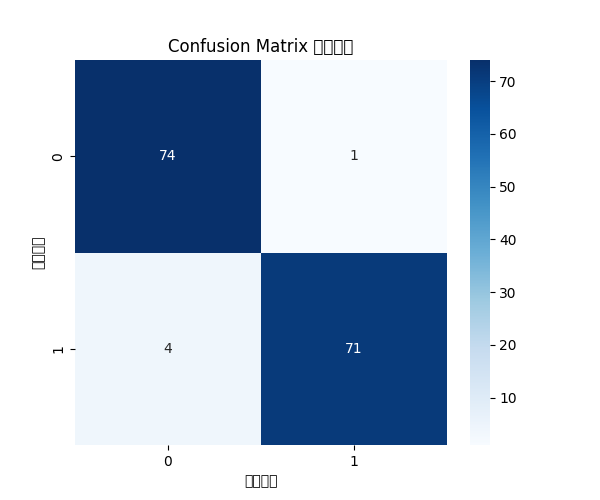

# 1.1 原始数据集可视化
### 使用sklearn的make_moons生成月牙形二分类数据集，样本总数1000，设置noise=0.15增加噪声，固定随机种子seed=42，保证实验可以复现。  
### 数据集包含2个输入特征，标签分为类别0、类别1，属于二分类任务。  
## 原始数据可视化结果如下图：

----
# 1.2 数据集划分
### 原始数据集一共1000条月牙样本，划分成训练集700条、验证集150条、测试集150条，比例7:1.5:1.5。
> ## 防止数据泄露：测试集不能参与训练、归一化等训练阶段操作，只用于最终评估。（类似于考试提前知道答案）
## 划分结果：
- 训练集：700个样本
- 验证集：150个样本
- 测试集：150个样本

----
# 1.3 记录训练过程指标，绘制损失曲线、准确率曲线
### 在每一轮训练结束后，记录训练集loss、验证集loss、训练集准确率、验证集准确率，存入列表
### 训练全部结束后，使用matplotlib绘制两张子图：损失变化曲线、准确率变化曲线。
### 从曲线可以观察模型收敛情况：训练loss与验证loss同步下降，训练acc、验证acc同步上升，模型收敛良好，没有明显过拟合现象
### 保存模型权重文件.pth，实现模型保存与加载

---- 
# 1.4 任务4：超参数对照实验，探究隐藏层神经元数量对模型拟合效果的影响
### 实验设计：控制单一变量，固定数据集、随机种子、学习率、训练轮数，仅修改MLP隐藏层神经元数量。
### 实验组1：隐藏层8个神经元。网络容量偏小，模型表达能力有限，容易欠拟合，拟合出来的决策边界更简单。
### 实验组2：隐藏层32个神经元。网络容量更大，能够学习更复杂的非线性边界，但神经元数量过多时，容易记住训练集噪声，产生过拟合。
### 实验结论：神经元数量过少，模型欠拟合，训练与验证集准确率都偏低；神经元数量过多，模型容量过大，容易发生过拟合，训练集准确率很高，但验证集效果下降。合适的网络容量需要根据任务复杂度选择。

----
# 1.5 任务5：在独立测试集上评估模型，绘制混淆矩阵
### 数据集划分时预留了测试集，测试集全程不参与模型训练、超参数选择，仅作为模型训练完成后的最终评估数据，避免数据泄露。
### 将训练完成的模型在测试集进行预测，计算测试集分类准确率。
### 绘制混淆矩阵，直观查看模型的分类情况：混淆矩阵可以看出模型错分样本数量，区分假阳性、假阴性。
### 结论：测试集准确率可以代表模型在全新未知数据上的泛化能力。
